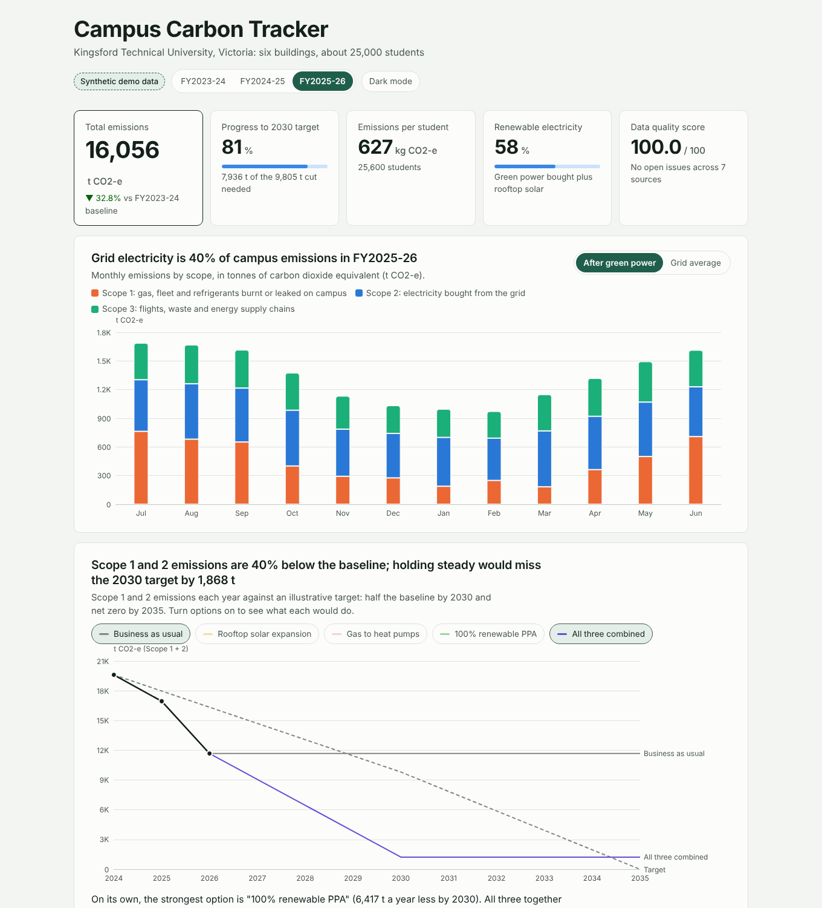

# Campus Carbon Tracker

**Live dashboard: https://vivekarya05.github.io/campus-carbon-tracker/**



A Scope 1, 2 and 3 greenhouse gas inventory and Net Zero tracker for **Kingsford Technical University**, a fictional
six-building Victorian campus with about 25,000 students. It turns three years of meter, bill and contractor data
into GHG Protocol emissions using Australian NGA Factors, checks the data like an auditor would, and tracks progress
against an illustrative 2030 / 2035 Net Zero pathway.

> **Synthetic demo data.** All campus activity data is generated (fixed seed). Emission factors are real published
> values (NGA Factors 2026, UK DESNZ 2026). See [Reference data](#reference-data).

## Key findings (FY2025-26, from `python -m pipeline.run`)

- **16,056 t CO2-e** in total (market-based), **33% below the FY2023-24 baseline** of 23,877 t. Counted at the
  grid average (location-based) the total is 23,420 t: almost all of the fall comes from buying renewable electricity.
- **Grid electricity is 40% of emissions**, natural gas 31%. Scope 1 + 2 is 11,673 t, which is **81% of the way** to
  the 2030 target of 9,805 t (half the baseline).
- **Holding steady misses 2030 by 1,868 t.** A 100% renewable PPA is the largest single lever (6,417 t a year);
  solar, heat pumps and a full PPA together bring Scope 1 + 2 to 1,225 t, leaving gas, fleet and refrigerants for 2035.
- **Heat pumps alone would add 1,691 t** while Victoria's grid stays coal-heavy (0.74 kg CO2-e/kWh, about 68 kg per GJ
  of heat at COP 3, versus 51.5 kg for gas): electrification only pays off with renewable supply.
- **Sports & Aquatic Centre** emits 589 kg CO2-e per m², 3.8 times the library, because of pool heating.
- **All four planted data problems were caught** (two missing gas months, a duplicated meter day, a meter logging Wh
  as kWh, a waste report 45 days late) with zero false alarms; FY2024-25 data quality scored 98/100.

## What this project demonstrates

- **Emissions accounting:** GHG Protocol Corporate Standard; Scope 1, Scope 2 location-based and market-based
  (GreenPower, LGCs, PPA, residual mix), Scope 3 categories 3, 5 and 6; NGA Factors; intensity metrics.
- **Data governance:** data owner register, data dictionary, certification evidence register, automated checks for
  completeness, timeliness, duplicates, units and ranges, negatives and outliers, a 0-100 data quality score and an
  issue log with open / resolved status.
- **Net Zero reporting:** baseline, target trajectory, abatement scenarios with tonnes abated and remaining gap.
- **Energy market analysis:** half-hourly interval data and a ready-made join to half-hourly AEMO VIC1 grid
  intensity for load-shifting analysis (see [Grid timing](#grid-timing)).
- **Engineering:** reproducible Python pipeline (pandas, numpy), 23 unit tests with hand-checked examples, static
  dashboard (HTML, CSS, Apache ECharts) on GitHub Pages, light and dark mode, mobile layout.

## Run it

```bash
pip install -r requirements.txt
python -m pipeline.run          # generate -> validate -> calculate -> scenarios -> export to docs/data/
python -m unittest              # or: python -m pytest
python -m http.server -d docs   # open http://localhost:8000
```

## Repo structure

```
pipeline/   generate.py   synthetic data, one CSV per data owner, with planted data quality issues
            validate.py   data quality checks, issue log and scores
            calculate.py  emissions by month, building, source and scope; grid timing
            scenarios.py  Net Zero target trajectory and abatement scenarios
            export.py     compact JSON for the dashboard
            run.py        runs everything
data/raw/         synthetic source files (facilities_*, fleet_*, procurement_*, travel_*, wastecontractor_*)
data/reference/   factors.csv, data_owners.csv, data_dictionary.csv, evidence_register.csv
data/processed/   cleaned tables, emissions_inventory.csv, data_quality_log.csv, data_quality_scores.csv
docs/             the dashboard (index.html), methodology.html and data/*.json
tests/            calculation and data quality tests
DECISIONS.md      every assumption and judgement call
```

## Reference data

| Data | Source | Notes |
|---|---|---|
| Electricity, gas, fuel, refrigerant (GWP) and waste factors | [Australian National Greenhouse Accounts Factors 2026](https://www.dcceew.gov.au/climate-change/publications/national-greenhouse-accounts-factors-2026), DCCEEW | Transcribed via the [emiz.com.au NGA library](https://www.emiz.com.au/factors/nga); Victorian electricity cross-checked with a second source citing NGA 2026 Table 1 |
| Diesel and petrol energy content | [NGA Factors July 2017, Table 4](https://agriculture.gov.au/sites/default/files/documents/national-greenhouse-accounts-factors-july-2017.pdf) | Fixed in the NGER Measurement Determination |
| Flight factors (with radiative forcing) | [UK DESNZ conversion factors 2026](https://www.gov.uk/government/publications/greenhouse-gas-reporting-conversion-factors-2026) | Via the [emiz.com.au DESNZ library](https://www.emiz.com.au/factors/desnz/air-travel) |
| Campus activity data | Synthetic | `pipeline/generate.py`, seed 42 |

Each row of `data/reference/factors.csv` records the value, unit, source table, publication, year, how it was
retrieved and what to verify. To use the official workbook instead, edit the values there; no code changes.

### Grid timing

This version counts every kWh at the flat NGA Victorian factor, as the dashboard states. The pipeline is ready for
real half-hourly data: save `data/reference/aemo/vic1_intensity_halfhourly.csv` with columns `interval_start,
energy_mwh, emissions_t, intensity_kg_per_kwh` (for example built from AEMO dispatch data with the
[nemed](https://github.com/UNSW-CEEM/NEMED) package) and rerun `python -m pipeline.run`. The dashboard then shows an
hour-by-month heatmap of grid intensity and the tonnes saved by moving 10% of each day's dirtiest-hour load to its
cleanest hours.

## Disclaimer

Kingsford Technical University is fictional and **all campus activity data is synthetic demo data**. The targets are
illustrative. Emission factors are published values, transcribed as described above. This is a portfolio project,
not a reported inventory.
